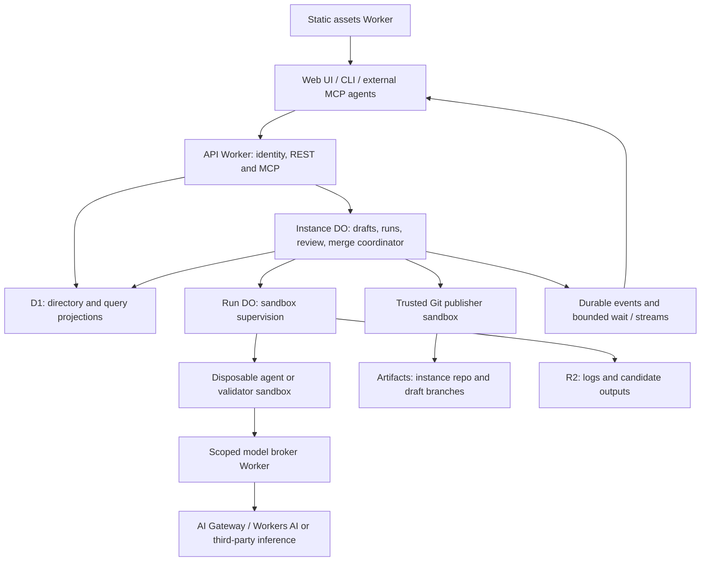

# Plan: a Cloudflare-hosted Schematics agent factory

Status: **proposed architecture and feasibility analysis**, researched November 5, 2026. This document does not describe a shipped factory.
Repository baseline: `994f80628971f416c1c26a7194cb6cf997feff0d`.

The product brief is the owner's November 5 conversation: Schematics manages many
configuration instances; each instance is a Git repository; users open durable
drafts, prompt isolated agents, inspect changes and checks, collect review, and
merge safely. Forma is the intended first language. UI, CLI, REST, and external
agents connected through an instance-scoped MCP should drive the same process.
This document restates that brief so it does not depend on a local attachment.

Read the companion [vision-versus-repository analysis](./analysis-factory-vision-vs-current-repo.md)
for the evidence behind what already exists and the product decisions that differ
from the repository's present direction.

## Recommendation and feasibility

**Yes: the application runtime, Git storage, agent execution, metadata, and model
routing can be hosted on Cloudflare, with infrastructure declared through
Alchemy.** That is a feasible target architecture, not something this checkout
can deploy today. The largest work is the durable collaborative product around
the agent, followed by proving Sandbox/Alchemy integration and merge correctness.

Keep the MVP focused on **create draft → run agent → validate → review → merge**.
Deploying Schematics itself to Cloudflare is in scope for this architecture;
applying user configuration to Salesforce or another external system is a
separate product operation and remains outside the factory MVP.

| Concern                                                      | Recommended Cloudflare component                           | Schematics still supplies                                                     |
| ------------------------------------------------------------ | ---------------------------------------------------------- | ----------------------------------------------------------------------------- |
| Web application                                              | Workers Static Assets, retaining the Astro/React surfaces  | Instance/draft navigation and review UI                                       |
| REST, MCP, auth boundary                                     | API Worker                                                 | Application services, tenancy, permissions, idempotency                       |
| Configuration history                                        | Artifacts, one repository per instance                     | Branch conventions, commit publication, review and merge policy               |
| Instance coordination and authoritative operational metadata | SQLite-backed Instance Durable Object                      | Drafts, messages, runs, checks, reviews, writer leases, merge intents, outbox |
| Disposable Linux execution                                   | Sandbox 1.x / Durable Object Container API                 | Pinned agent/toolchain image, lifecycle supervision, cancellation             |
| Catalog and query projections                                | D1                                                         | Tenant/instance directory and rebuildable list/search projections             |
| Large outputs                                                | R2                                                         | Logs, diagnostic bundles, attachments, retention and access policy            |
| Model access                                                 | AI Gateway, optionally Workers AI                          | Effect model adapter, capability validation, budgets and attribution          |
| Recovery and background work                                 | Durable Object alarms first; Queues or Workflows if needed | Retryable operations, deduplication, reconciliation                           |
| Provisioning                                                 | Alchemy v2, extending the existing stack                   | Stage isolation, migrations, image publication, teardown rules                |

Cloudflare Artifacts provides Git storage and repository management. It does not
replace Schematics' draft database, collaboration UI, or review rules. Its repo
model and access scopes are documented in
[How Artifacts works](https://developers.cloudflare.com/artifacts/concepts/how-artifacts-works/).
Cloudflare's [current Sandboxes overview](https://developers.cloudflare.com/sandbox/)
describes isolated Linux containers controlled by Workers and Durable Objects.

### What “totally on Cloudflare” means

There are three different promises:

1. **Cloudflare application hosting:** no always-on Node server, external Git
   host, or external database is required for an instance to operate. This is the
   recommended target.
2. **Cloudflare model access and billing:** AI Gateway can remove OpenRouter as a
   required intermediary. Calls to third-party models still leave Cloudflare for
   inference. Only selecting supported Workers AI-hosted models gives the narrower
   Cloudflare-hosted inference path; test model quality and tool support first.
   [Unified Billing](https://developers.cloudflare.com/ai-gateway/features/unified-billing/)
   describes the supported model access and billing choices.
3. **Cloudflare-only development supply chain:** the current project repository,
   CI, package downloads, and base-image supply chain are not Cloudflare-only.
   GitHub Actions can continue building and invoking Alchemy while every deployed
   application service runs on Cloudflare. Replacing that CI is separate scope.

“Everything via Alchemy” should mean infrastructure and its configuration are
declared in code. Runtime instance repositories, drafts, and runs are application
data created through services; do not add an Alchemy resource per user draft.
Account enrollment, payment credits, and external identity-provider credentials
remain bootstrap inputs, even when the related resources have API coverage.

## Existing foundation

The current [stack](../alchemy.run.ts) already declares a static playground and
API Worker with Cloudflare-backed Alchemy state. The
[API resource](../alchemy/schematics-api-worker.ts) binds workspace Durable
Objects and a stage-specific Artifacts namespace. Production and PR preview
workflows deploy through Alchemy, and a scheduled cleanup workflow exists.

The implementation currently has a different topology:

- [Workspace Durable Objects](../packages/cloudflare/src/workspace-object.ts)
  own editable file snapshots and revision changelogs.
- The [hosted router](../packages/cloudflare/src/worker-runtime.ts) creates one
  repository per workspace and proxies Git smart HTTP with server-side tokens.
- [Browser Git](../apps/playground/src/hosted-git.ts) commits and pushes snapshots,
  including a draft branch demonstration. It can log a Git failure while the
  preceding workspace edit has already succeeded.
- The [chat adapter](../packages/agent/src/openrouter-proxy-runtime.ts) runs the
  bounded tool loop in the client. The Worker proxies model requests; closing a
  browser is not a durable server-run lifecycle.

These are useful components. They do not establish Git-authoritative instances,
independent draft state, a durable run service, or authorized merge gates. The
[deployment-modes guide](./architecture-deployment-modes.md) explains the current
topology, with some historical names and links noted in the companion analysis.

## Target topology and ownership



The Instance DO is a per-instance coordination boundary, not one global lock for
the factory. Many instances and many draft sandboxes can run concurrently. Keep
network I/O and compiler work outside storage transactions. An async DO method
can interleave at awaits; single-object routing alone is not a merge lock. Use
persisted operation states, transactions for local state transitions, and fenced
leases for long operations.

The Run DO controls execution; it reports events to the Instance DO, whose run
record is authoritative. The D1 directory can be authoritative for tenant and
instance allocation, but its draft/run list projections are not authoritative for
review, run completion, or merging. Keep those queries on the owning Instance DO.
This avoids pretending D1, multiple DOs, and Git share a transaction.

### Durable versus disposable data

| Data                                                                       | Authority                                                                   | Recovery rule                                                         |
| -------------------------------------------------------------------------- | --------------------------------------------------------------------------- | --------------------------------------------------------------------- |
| Source tree, canonical history, draft heads                                | Artifacts Git refs and commits                                              | Fetch by recorded SHA; reconcile metadata after ambiguous pushes      |
| Instance membership, drafts, conversation, run lifecycle, review decisions | Versioned operational records in owning services                            | Migrate and back up independently of Git                              |
| Required checks                                                            | Check records keyed by commit, toolchain/package digest, and policy version | Recompute when any input changes                                      |
| Workspace checkout and running process                                     | Disposable sandbox                                                          | Recreate from Git plus durable run input; recover optional checkpoint |
| Logs and candidate file manifests                                          | R2 objects referenced by durable records                                    | Retain with ownership and lifecycle policy                            |
| D1 list/search views, UI caches                                            | Projections                                                                 | Rebuild from authoritative records                                    |
| Model and Git credentials                                                  | Worker-side secret/binding or narrowly scoped broker                        | Never recover from repository files or agent output                   |

The brief suggested Postgres. It is not necessary for this MVP if we use the
above ownership model. An externally hosted Postgres through Hyperdrive would
relax the Cloudflare-only runtime goal. D1 is SQLite rather than a drop-in
Postgres replacement; design migrations and queries accordingly. Its paid
database size limit is currently 10 GB, so archive bulk events to R2 and plan
catalog sharding before growth demands it.
[D1 limits](https://developers.cloudflare.com/d1/platform/limits/).

This proposal adds operational factory records, not a second semantic definition
graph. The current [constellation guide](./architecture-constellation.md) assigns
definition/release/observation persistence to a future Triplex integration.
Operational metadata can remain behind ports while that decision is resolved;
Git source history does not automatically replace Triplex's intended semantics.

## Product records and contracts

All names below are proposed; the current workspace API is not being renamed by
this document.

| Record            | Minimum durable fields                                                                                                               |
| ----------------- | ------------------------------------------------------------------------------------------------------------------------------------ |
| Instance          | Tenant/instance IDs, repository identity, canonical branch, language/toolchain policy, status                                        |
| Draft             | Instance/draft IDs, author, title, branch, base SHA, head SHA, review state, version                                                 |
| Thread/message    | Draft/thread ID, ordered message ID, principal, content or attachment refs, timestamp                                                |
| Run               | Run ID, triggering message, input SHA/history boundary, model policy, status, attempt, lease epoch, deadline, result SHA/disposition |
| Workspace lease   | Run/attempt, sandbox identity, expiry, fencing epoch; never the identity of the draft                                                |
| Check             | Commit SHA, check name, toolchain/packages/policy digests, status, diagnostics/log refs                                              |
| Review/comment    | Principal, reviewed SHA, decision, anchor/path/side/range, blocking/resolution state                                                 |
| Merge intent      | Operation ID, draft SHA, expected main SHA, candidate SHA, check basis, policy, state                                                |
| Event/outbox item | Owner, monotonic sequence or operation ID, schema version, payload/ref, delivery state                                               |

A draft may remain `open` across many runs. Review states are `open`, `in_review`,
`approved`, `merged`, and `closed`; initialization failures belong to a separate
provisioning state. `approved` is a policy-derived readiness state, invalidated by
new commits or a changed policy. Run states include `queued`, `provisioning`,
`running`, `waiting_for_input`, `finalizing`, `completed`, `failed`, `canceled`,
and `timed_out`.

Recommend one persistent conversation per draft with independent finite runs,
each reading a recorded history boundary. That resolves an open question in the
brief without tying the draft to a provider-specific live session. A future
provider continuation token is optional execution metadata.

### Draft creation and the first commit

An empty Git repository has no commit to branch from. Instance initialization
must create an initial commit, even for an empty tree, before creating drafts.
Use a separate retryable `initializing → ready/failed` instance lifecycle.

For `create draft`, authorize the instance, deduplicate the request, read a
canonical SHA, and atomically persist the draft, initial message, optional queued
run, and an initialization outbox item in the owning Instance DO. Return the
stable draft/run IDs promptly. An idempotent background operation then creates
`draft/<id>` at that exact SHA and provisions execution. A newer main does not
silently change the recorded base.

The outbox cannot be atomically committed with Artifacts or a Queue. Persist the
intent and a recovery wake-up using the owning store's supported transaction
semantics, then dispatch. An alarm retries undelivered work. Mark delivery only
after an acknowledgement; duplicate dispatch uses the same operation ID. A
reconciler must also detect stale provisioning records and repair missed wake-ups.
Treat [DO alarms](https://developers.cloudflare.com/durable-objects/api/alarms/)
as an at-least-once mechanism, not an exactly-once promise.

## Agent execution on Cloudflare Sandbox

Use a Linux sandbox with native Git and a pinned toolchain. Workers handle
control-plane HTTP and Effect services; they are not a shell or durable Linux
filesystem. The current isomorphic-git bundle issue is a constraint of this
repository's Worker integration, not a universal Cloudflare prohibition on Git.

**Version choice matters:** current Sandbox 1.x uses an application-owned Durable
Object and `this.ctx.container`; earlier examples using an SDK-owned `Sandbox`
class and `getSandbox()` describe 0.x. Cloudflare moved lifecycle, retry, timeout,
and recovery decisions into application code.
[Sandbox 1.0 changes](https://developers.cloudflare.com/sandbox/sdk/migrate/changes-in-1-0/).
The published [Artifacts/Sandbox example](https://developers.cloudflare.com/artifacts/examples/sandbox-sdk-artifacts/)
still uses a `#v0` template; it demonstrates the Git concept, not a version-matched
implementation to paste into this project.

The recommended run protocol is:

1. Acquire a fenced writer lease for the draft. Queue another prompt or reject a
   conflicting write; allow other drafts to proceed.
2. Start a sandbox from a recorded image digest and fetch the draft's input SHA.
   Resolve only pinned packages through an allowlisted source or prebuilt cache.
3. Run the existing Effect-oriented agent/tool layer inside the sandbox, with
   file/search/command/check tools adapted to that checkout. Save ordered events
   and tool results durably as the run progresses.
4. Supervise the sandbox with alarms and a deadline independent of the client.
   Report heartbeats, resource usage, input requests, and cancellation state.
5. Export candidate changes and a content-digested manifest to durable storage.
   A trusted publisher creates and pushes a server-owned commit on the draft.
6. Run authoritative checks for that committed SHA, persist the result and
   terminal run disposition, release the writer lease, and stop the sandbox.

A process running inside a container does not by itself keep its DO active.
Current [lifetime guidance](https://developers.cloudflare.com/sandbox/concepts/lifetime/)
requires activity supervision or an appropriate inactivity timeout; container
disk and processes disappear on stop. Snapshots can accelerate recovery, but Git
and durable run records must be enough to recover a draft. Unpublished edits can
only survive a crash if checkpointed; otherwise report their loss and retry from
the last published revision. Do not promise exactly-once agent execution.

Cloudflare's [coding-agent runner tutorial](https://developers.cloudflare.com/sandbox/get-started/build-a-coding-agent-runner/)
shows background execution, outbound restrictions, and keeping model credentials
in the Worker. Use those patterns without adopting a particular commercial agent
CLI as a mandatory Schematics dependency.

### Permissions and Git publication

Artifacts' documented Git tokens grant repository-level `read` or `write`
access. Do not interpret them as branch protection. A write token for the
instance repo can undermine review if exposed to the agent. Authentication
details are in [Artifacts authentication](https://developers.cloudflare.com/artifacts/guides/authentication/)
and [Git protocol](https://developers.cloudflare.com/artifacts/api/git-protocol/).

For the MVP, the authoring sandbox receives read access and a scoped candidate
upload capability, with **no canonical repository write token**. The model broker
binds requests to the run and permitted model policy. Trusted publication uses a
separate fresh process/sandbox that never runs repository scripts. It validates
candidate paths, sizes, symlinks, base SHA, and lease epoch; disables repository
hooks/config-driven execution; stages only accepted content; and pushes only the
intended ref with an expected old SHA. A reviewer gets read-only tools and cannot
create an authoritative approval just by printing “approved” in a message.

Alternative: isolate agents in separate Artifacts forks, then import their
commits through the publisher. This costs extra repos and cleanup but gives a
natural repository-scoped write boundary. A raw Git HTTP proxy that merely
injects a write token is insufficient to enforce allowed ref updates. Building
a protocol-aware receive-pack authorization layer is another option, with a
larger validation burden than the MVP needs.

Human edits and later direct-agent editing must acquire the same draft writer
coordination and publication contract. A stale lease must never publish over a
new run. Egress restrictions and credential injection belong outside the process
that executes agent-authored code; no deployment credentials belong in it.

## Checks, review, and merging

Forma should be a replaceable language integration with operations for checking,
package resolution, diagnostics, and optional rendering. Install a versioned
compiler into the image, pin package versions/integrity in the repository, and
record those digests on check results. No Forma binary, compiler adapter, or
Open Ontology package resolver is shipped in this repo today. Do not invent a
package name, grammar, registry, or undocumented CLI flag to make the plan look
executable.

Start with source diffs and structured diagnostics. Reuse the existing JSON/YAML
providers as an integration fixture while the real Forma toolchain contract is
verified. That fixture proves infrastructure, not the Forma acceptance criterion.
Run required checks from a trusted, pinned validator image against the exact
published commit. Agent-produced check text is advisory.

### Merge protocol

The initial policy can require passing checks, one authorized human approval of
the current draft SHA, and no unresolved blocking comments. Add an optional
read-only reviewer agent through the same run mechanism. Keep policy small but
bind every decision to a revision and policy version.

1. The Instance DO records a merge intent for draft head `D` and canonical head
   `M`, rejects concurrent merge operations, and prevents that draft changing
   while the intent is finalized.
2. A trusted Git executor constructs candidate `C` from exactly `M` and `D` in a
   disposable checkout. Conflicts return a structured conflict result; they do
   not trigger automatic conflict resolution on main.
3. Required checks validate `C`, with toolchain/package/policy basis recorded.
   Existing draft checks alone are insufficient when main changed.
4. Re-read draft head, approvals, blocking comments, policy version, and lease.
   If any input changed, stop and recompute. Then attempt a conditional ref
   update from `M` to `C`, verifying that `C` descends from `M`.
5. Persist `merged`, `C`, and its audit event only after the Git operation is
   confirmed. If the response is lost, reconcile the recorded candidate SHA
   against the remote before retrying or claiming success.

Git documents explicit expected-ref leases in
[git push](https://git-scm.com/docs/git-push). Verify the actual Artifacts/native
Git combination rejects stale ref updates in an account-backed spike. Do not
assume multi-ref atomic pushes, protected branches, merge queues, or server-side
hooks are supplied by Artifacts. The protocol needs only one conditional
canonical ref update, not a distributed Git/database transaction.

If main advances, build and check a fresh candidate against the new main.
Retain approval of `D` only under an explicit policy; request fresh approval if
rebasing or resolving conflicts changes the reviewed draft revision. A crashed
merge coordinator must recover its intent before admitting another merge.

Merge is distinct from apply. The existing reconciliation engine may later
plan/apply an approved canonical release, with external-system credentials and
an independent approval boundary. A passing compiler check does not establish
that external API mutations are authorized or will succeed.

## REST and external-agent MCP

REST and MCP should call the same application services. Existing document RPC
can remain the editor's file-level adapter underneath those services. Keep wire
schemas in `protocol`, model/tools in `agent`, editor composition in `ide`, and
HTTP/MCP adapters in server packages. A new React-free factory service package
is reasonable; keep Cloudflare-specific storage/execution layers outside it.

Proposed HTTP resources:

```text
POST /v1/instances
GET  /v1/instances/:instanceId
POST /v1/instances/:instanceId/drafts
GET  /v1/instances/:instanceId/drafts
GET  /v1/drafts/:draftId
POST /v1/drafts/:draftId/messages
POST /v1/drafts/:draftId/runs
GET  /v1/runs/:runId
GET  /v1/runs/:runId/events?after=:cursor
GET  /v1/runs/:runId/wait?after=:cursor&timeoutSeconds=30
POST /v1/runs/:runId/cancel
GET  /v1/drafts/:draftId/diff?revision=:sha
GET  /v1/drafts/:draftId/checks?revision=:sha
POST /v1/drafts/:draftId/checks
POST /v1/drafts/:draftId/submit
POST /v1/drafts/:draftId/comments
POST /v1/drafts/:draftId/reviews
POST /v1/drafts/:draftId/merge
```

Create/start operations accept an idempotency key scoped to principal, instance,
and operation; mismatched reuse is a conflict. Posting a message does not start
execution unless explicitly requested. Return `202` plus durable IDs for work
still initializing. Mutation preconditions include the expected revision where
appropriate; return structured `409` conflicts and policy/permission failures.

Serve an MCP endpoint such as `/v1/instances/:instanceId/mcp`. Authenticate the
user/service principal, bind the instance from the route and grant, and authorize
every tool call. A URL or opaque ID does not confer permission. Support
OAuth-compatible remote clients and scoped service credentials; browser Access
alone does not establish interoperability with every MCP client. Cloudflare
documents [Streamable HTTP transport](https://developers.cloudflare.com/agents/model-context-protocol/protocol/transport/)
and [remote MCP authentication](https://developers.cloudflare.com/agents/model-context-protocol/guides/remote-mcp-server/).
An SDK adapter can be used without replacing the Effect application services.

Expose `create_draft`, `prompt_draft`, `wait_for_run`, `get_draft`, `get_diff`,
`submit_draft`, and separately authorized `merge_draft`, plus discoverable
instance/package documentation resources. Delegated execution is the first
mode. Direct external-agent file editing is later and must converge on the same
draft, publication, checks, and review contracts.

### Waiting for a run to settle

“Agent stopped speaking” is not a durable completion condition. Define:

- **Terminal execution:** completed, failed, canceled, or timed out.
- **Settled result:** terminal execution, final revision or explicit no-change/
  unpublished-output disposition persisted, and required checks for the result
  revision in a terminal state. Infrastructure errors and canceled checks are
  terminal dispositions that block review, not passing checks.
- **Waiting for input:** return immediately with `settled: false` and the input
  request. It is not a terminal successful run.
- **Ready for review / mergeable:** separate policy evaluations on the draft's
  current revision. An older settled run may no longer describe its latest head.

An example bounded wait result is:

```json
{
  "runId": "run_456",
  "status": "completed",
  "settled": true,
  "revision": "<full-commit-sha>",
  "checks": { "status": "failed", "revision": "<full-commit-sha>" },
  "draft": { "id": "dr_123", "readyForReview": false },
  "cursor": "42"
}
```

A completed run can settle with failing checks. A deadline must also settle a
stuck validator into an explicit failure. A wait timeout returns current state
and a resumable cursor; it never cancels the underlying run. Persist monotonic
event IDs and replay after a cursor; live SSE/WebSocket delivery is an optional
acceleration. Clients must be able to recover from a dropped stream using GET.
Bound MCP waits, for example to 30 seconds, to fit transport and client budgets.

## Model routing choices

| Mode                                    | Benefit                                                   | Limitation / recommendation                                                     |
| --------------------------------------- | --------------------------------------------------------- | ------------------------------------------------------------------------------- |
| Existing OpenRouter adapter             | Fastest path using shipped contracts                      | External routing/billing; keep as an optional compatibility adapter             |
| AI Gateway forwarding to OpenRouter     | Adds Cloudflare gateway policy and visibility             | Still depends on OpenRouter; does not meet the replacement goal                 |
| AI Gateway with Unified Billing or BYOK | Cloudflare routing and supported third-party model access | Model/provider feature coverage and billing setup must be verified              |
| Workers AI via Gateway                  | Cloudflare-hosted inference for supported models          | Coding quality, context, tools, structured output, and capacity need evaluation |

The current [AI REST API](https://developers.cloudflare.com/ai-gateway/usage/rest-api/)
has an OpenAI-compatible `/accounts/{account_id}/ai/v1/chat/completions` endpoint
and separate Responses/Messages surfaces. Implement and test an adapter rather
than assuming OpenRouter response extensions, authentication, or model IDs work
unchanged. The inference API and gateway-management API use distinct permission
requirements; keep their credentials separate.

Start with a fixed vetted model and an explicit fallback list. Cloudflare also
offers [dynamic routes](https://developers.cloudflare.com/ai-gateway/features/routing/dynamic-routing/)
and [Auto Router](https://developers.cloudflare.com/ai-gateway/features/routing/auto-router/),
currently marked beta. Record the actual provider/model selected on every turn,
not only a route alias. Verify that fallback preserves tool calls, structured
outputs, context requirements, cancellation, and usage accounting. Tag requests
with tenant/instance/draft/run IDs, enforce run budgets, and configure prompt-log
retention. Do not retry mutating tools just because inference retried.

## Alchemy deployment and environment strategy

Keep the existing `alchemy.run.ts` entrypoint and pinned Effect/Alchemy versions
as the starting point. `alchemy` / `@alchemy.run/cloudflare` provision this
application; `@schematics/alchemy` is the repository's separate external-resource
reconciliation library. They have different responsibilities.

The installed `@alchemy.run/cloudflare@2.0.0-beta.84` sources were inspected for
this analysis. They include Artifacts namespaces, D1, R2, Queues, Workflows,
`AI.Gateway`, `AI.GatewayDynamicRouting`, and DO-managed Container declarations.
This establishes API surface, not tested deployment compatibility. Relevant
upstream guides are [Artifacts](https://alchemy.run/cloudflare/data/artifacts/),
[Containers](https://alchemy.run/cloudflare/compute/containers/), and
[AI Gateway](https://alchemy.run/cloudflare/ai/ai-gateway/).

| Resource family              | Existing or proposed wiring                                                                    | Verification needed                                                  |
| ---------------------------- | ---------------------------------------------------------------------------------------------- | -------------------------------------------------------------------- |
| Static assets and API Worker | Existing `Website.StaticSite` and `Worker`                                                     | Preserve API URL output and production-only domains                  |
| Git                          | Existing stage-named `Artifacts.Namespace`                                                     | Repos are runtime data; binding removal does not prove repo deletion |
| Instance metadata            | New DO class and explicit storage migration                                                    | SQLite capability, migrations, rollback behavior, backup             |
| Execution                    | New Run DO plus `Container` with `schedulingPolicy: "durable_object"` in its `containers` list | Image publication, native API, size at `start()`, local parity       |
| Catalog and outputs          | D1 database/migrations, R2 bucket/lifecycle                                                    | Projection replay, retention, cleanup and recovery                   |
| Models                       | `AI.Gateway`, optional routing resource and AI binding/broker                                  | Explicit authentication, supported route schema, secrets, billing    |
| Recovery                     | DO alarms initially; optional Queue/Workflow resource                                          | Deduplication and no lost dispatch                                   |

Two concrete compatibility issues deserve early tests:

- Alchemy beta.84's `src/AI/Gateway.ts` resolves omitted authentication to
  `false`. Cloudflare now rejects new unauthenticated gateways. Declare
  `authentication: true` explicitly; do not copy an older default-only example.
  This requirement changed November 3, per the
  [AI Gateway changelog](https://developers.cloudflare.com/changelog/product/ai-gateway/).
- Its DO-managed Container mode attaches images to the owning DO; instance size
  and execution settings belong at runtime `start()`, rather than copying fleet
  `maxInstances`/`instanceType` settings into that declaration. Prove the exact
  beta.84 path with a small spike before adding the factory runner.

If a needed API is missing or mismatched, add a small Alchemy provider or upgrade
in an isolated compatibility change. A dashboard-only step is not an acceptable
silent substitute for a claimed reproducible stack. Secret values remain
deployment inputs; user repositories must never receive the infrastructure token.
New secret declarations should retain redaction/encryption semantics through
Alchemy state and logs. The current Worker configuration unwraps an optional
OpenRouter secret; audit its upload/state representation during that work.

### Local development, remote dev, and previews

| Environment                  | Purpose                                                                            | State and credentials                                                                 |
| ---------------------------- | ---------------------------------------------------------------------------------- | ------------------------------------------------------------------------------------- |
| Offline local                | Fast package/service iteration, deterministic agent, native Git and local executor | Temp repos, local DB/storage adapters; no cloud/model key                             |
| Local Cloudflare integration | Exercise Worker, DO, and Linux image behavior                                      | Workerd/Docker as supported by the pinned Alchemy path; explicit remote bindings only |
| Remote `dev-<developer>`     | Prove real Artifacts/Sandbox/model integration                                     | Isolated stage, synthetic instances, quota and expiry                                 |
| PR `pr-<number>`             | Review a version of Schematics itself                                              | Isolated workers, DOs, D1, R2, Git namespace, gateway attribution and run caps        |
| Production `prod`            | Canonical hosted application                                                       | Retained tenant data, migrations, restricted deploy credentials                       |

The Node/pnpm toolchain remains **25.9.0 / 11.1.3**. Install Forma and its actual
runtime dependencies in a pinned Linux image once the compiler contract is
verified. Prefer digest-addressed images; remote development and PR stages can
reuse immutable image blobs while their application state stays isolated.

Keep current GitHub Actions production gating after successful main CI. Extend
PR deploys to include the new resources, then test hosted behavior. Same-repo
preview restrictions already exist, but deploy jobs execute PR code with
credentials: retain a trusted-contributor/approval policy, minimize token scope,
and prefer a separate preview account. Never seed previews with production data
or SaaS mutation credentials.

A **Schematics PR preview** previews a code change to the factory. A **draft
preview** previews configuration inside a running factory. They need different
identities and lifecycles. Do not provision an entire infrastructure stack for
each configuration draft; optional sandbox-rendered previews use authenticated
routes on a separate origin from the application.

### Teardown, migrations, and recovery

Extend cleanup beyond destroying declared workers. Stage-scoped Git namespaces
are naming boundaries, not automatically owned repository inventories: runtime
repos, DO data, R2 outputs, snapshots, and in-flight runs need explicit policies.
Maintain a stage manifest and expiry registry. On preview closure, stop dispatch,
cancel/drain runs, revoke capabilities, delete only that preview's runtime data,
then destroy resources. Repeat cleanup safely after partial failure. Production
data deletion requires an explicit retained-data policy and is never a side
effect of changing a resource name.

Use additive metadata migrations and versioned run/event payloads. Record the
runner image and validator version on each run; a rollout must not interpret old
events with an incompatible decoder. Back up both Git and operational metadata,
test restoration, and periodically reconcile Git heads with pending publication/
merge intents. Git replication alone does not restore conversations or approvals.

### Transition from existing hosted workspaces

Introduce factory APIs alongside the current workspace demo. For an existing
workspace import, freeze its writes, read the DO snapshot and Git head, and
reconcile any unpushed edits explicitly. Publish the chosen snapshot as a known
commit, create the instance and its legacy-workspace mapping, then verify a fresh
Git checkout reproduces it before enabling factory writes. Preserve existing
history where available; record the import boundary where history is incomplete.
Do not infer tenant ownership from a workspace URL or invent old conversations
and approvals from commit trailers. New factory drafts use independent execution
workspaces and the common publication service. Keep legacy endpoints readable
until callers migrate, and ensure their write paths cannot bypass that service
after import. This is a data migration, not a resource rename.

## Limits, costs, and operational risks

These are point-in-time planning inputs, not a quote or capacity commitment.

- New Artifacts repos currently have a **1 GB** storage limit; pushes are capped
  at **64 MiB**, files at **32 MiB**. Keep generated media/logs in R2 and source
  in Git. The [Artifacts limits](https://developers.cloudflare.com/artifacts/platform/limits/)
  page also describes account and rate limits. Existing pre-September-29 repos
  have a different size allowance; do not design the MVP around that legacy cap.
- Artifacts billing is scheduled to start **November 12, 2026**. Published rates
  are 10,000 operations and 1 GB-month included, then $0.15/1,000 operations and
  $0.50/GB-month. Commit/push useful checkpoints rather than every keystroke.
  [Artifacts pricing](https://developers.cloudflare.com/artifacts/platform/pricing/).
- Sandbox capacity inherits Containers. `standard-1` currently supplies 0.5 vCPU,
  4 GiB memory, and 8 GB disk; benchmark Forma/package installation before
  selecting a size. Concurrency must be bounded per tenant and stage, then
  admitted against account resource limits.
  [Container limits](https://developers.cloudflare.com/containers/platform/limits/).
- Containers charge provisioned memory/disk while running and active CPU usage.
  Published overage rates are $0.0000025/GiB-second, $0.000020/vCPU-second, and
  $0.00000007/GB-second respectively. Our illustrative five-minute `standard-1`
  run with 30 active vCPU-seconds costs about **$0.003768** before allowances,
  network, Worker/DO, storage, and model charges. This is an arithmetic example,
  not a measured run. Idle sandboxes continue consuming memory/disk budget.
  [Container pricing](https://developers.cloudflare.com/containers/platform/pricing/).
- Workers have isolate CPU/memory limits; keep compiler/build processes in the
  sandbox and stream large logs to R2 instead of materializing them in an API
  response. [Workers limits](https://developers.cloudflare.com/workers/platform/limits/).
- A SQLite-backed DO currently has a **10 GB** storage limit and a **2 MB**
  maximum row size. Store large messages/tool outputs by reference and archive
  old event segments to R2. Per-instance coordination also needs a measured
  throughput budget. [DO limits](https://developers.cloudflare.com/durable-objects/platform/limits/).

Track cold-start/clone/package-install time, run and validator duration,
model/tool usage, Git operation count, queue latency, stale leases, failed
publication/merge intents, and idle sandbox time. A cost model should include
all of those plus image storage and retention, rather than multiplying token
usage alone. Alert on growing outboxes and ambiguous Git publications.

| Risk                                  | Design response / proof required                                                                                    |
| ------------------------------------- | ------------------------------------------------------------------------------------------------------------------- |
| Cloudflare beta/API or Alchemy drift  | Pin compatible versions, exercise an account-backed integration stage, retain ports for alternate executors/remotes |
| Browser/Worker disconnect             | Durable run records and background supervision; bounded waits with replay                                           |
| Duplicate dispatch or expired lease   | Operation IDs, persisted epochs, publisher rejects stale results                                                    |
| Check spoofing or unsafe Git access   | Trusted checks and publisher isolated from agent code; no repo write token in authoring sandbox                     |
| Main advances during review           | Candidate checks against current main plus expected-SHA update                                                      |
| Sandbox loss or deployment during run | Explicit recovery/disposition, recorded image/toolchain, no correctness dependency on warm disk                     |
| One large/hot instance                | Measure per-instance serialization and metadata size; partition event/output storage before sharding coordination   |
| Metadata/Git disagreement             | Durable publication/merge intent, inspect remote, repair before acknowledging success                               |

Cloudflare Workflows can later orchestrate coarse provisioning/check steps and
durable waits; Queues can distribute dispatch. Neither turns arbitrary Effect
fibers into durable execution. Do not require both in the first milestone.
Evaluate [Workflow events](https://developers.cloudflare.com/workflows/build/events-and-parameters/)
and [limits](https://developers.cloudflare.com/workflows/reference/limits/)
against measured needs. This infrastructure orchestration is distinct from
WorldVM's future durable business Programs and Schema Reflection's checkpoint
prototype.

## Delivery sequence and acceptance gates

| Phase                      | Deliverable                                                                                                 | Evidence required before moving on                                                                                                                 |
| -------------------------- | ----------------------------------------------------------------------------------------------------------- | -------------------------------------------------------------------------------------------------------------------------------------------------- |
| 0 — integration spikes     | Alchemy-deployed DO-managed sandbox, Artifacts native Git, one AI Gateway call, real Forma command contract | Create initial commit/branch; push/fetch; reject stale ref update; stop/recreate sandbox; authenticated gateway/tool call; validated Forma fixture |
| 1 — durable instance/draft | Instance repo + initial commit, metadata migrations, draft API, transactional outbox                        | Idempotent retries after failure between metadata commit and branch creation; two independent drafts                                               |
| 2 — delegated runs         | Server-run agent, leases, events, cancel/wait, trusted publication                                          | Browser can close; duplicate dispatch does not start a second writer; stale attempts cannot publish; run recovery and budgets                      |
| 3 — checks and review      | Pinned Forma checks, diffs, comments and revision-bound approval                                            | New commit invalidates approval; failing/timed-out checks block review; external agent can inspect the result                                      |
| 4 — merge and MCP          | Instance-scoped tools, OAuth/service auth, fenced merge protocol                                            | Two concurrent drafts preserve history; changed main triggers candidate recheck; interrupted merge recovers                                        |
| 5 — hosted lifecycle       | Remote dev/PR/prod resources, migrations, smoke and cleanup                                                 | Preview data/credentials cannot reach prod; close/destroy/retry leaves no orphan runs/repos; restore drill                                         |

The defining MVP demonstration is two users creating drafts against one instance,
agents authoring Forma changes concurrently in isolated sandboxes, the users
reviewing exact revisions, and both changes merging safely. Repeat the same flow
from an external MCP client using create → prompt → wait → inspect → submit;
merge only with a separately authorized principal. Include a failure/retry and a
main-advanced case. Passing current repository checks or creating a Worker URL
does not establish those product capabilities.

## Decisions still requiring validation

The recommended defaults are one instance repo, one writer per draft, finite
runs over durable conversation history, Instance DO operational ownership,
Artifacts as source authority, fixed-model Gateway access first, and no live
SaaS apply in the MVP. Remaining decisions are:

- Confirm Forma's distributable compiler, package source/integrity format,
  runtime requirements, licensing/access, and structured diagnostic interface.
- Resolve whether Open Ontology is a domain-package ecosystem in this product
  vision or the workflow product described by current repo docs; do not build an
  assumed registry contract.
- Confirm the metadata/Triplex boundary and the minimal cross-user auth policy.
- Prove beta.84's native Container deployment and Artifacts conditional push
  behavior in the intended account, including failure recovery.
- Choose the first supported coding model using tool/diagnostic evaluations,
  then decide whether Workers AI inference satisfies the product's quality bar.
- Agree on merge style and approval retention when main advances, plus preview
  retention and tenant/run budgets.

Those are concrete spike/product questions, not reasons to rebuild the existing
editor, provider contracts, or infrastructure stack from scratch.
